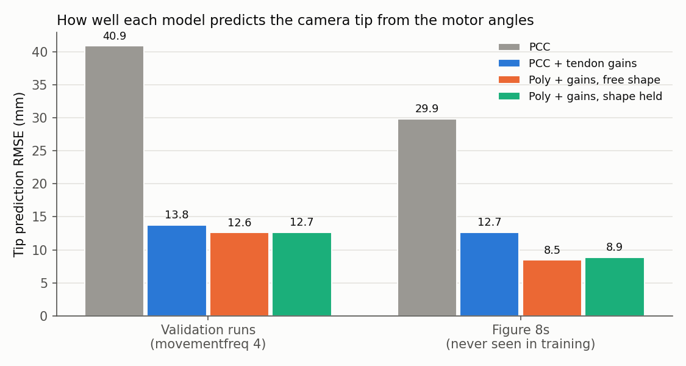
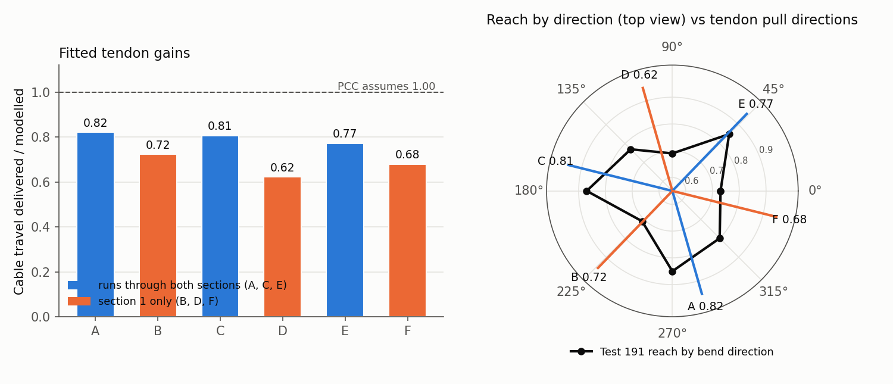
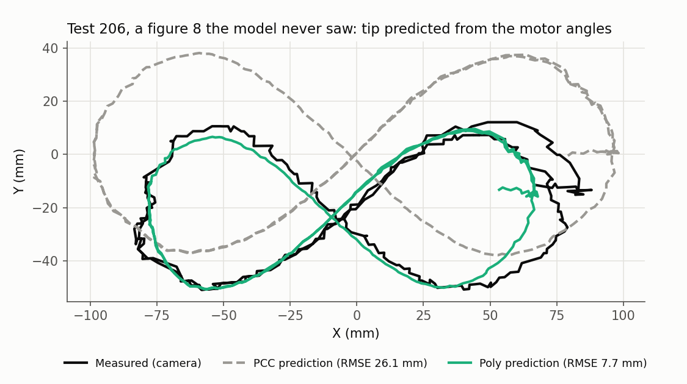

# How the Poly model constants were derived

This explains how the constants in `Core/Poly/polyConstants.json` were found, why each modelling choice was made, how well the result predicts the robot, and how the constants are used by the three control methods compared in the thesis: PCC, cable-compensated PCC and Poly. Everything here can be rerun with:

```bash
python Results/calibration/polyFit.py        # fits the constants, prints every table below, saves the JSON
python Results/calibration/polyFigures.py    # redraws the figures in Results/calibration/figures/
```

## Summary

- **The Poly model's constants were fitted to the logged tests.** It predicts where the tip will be from the motor angles, and the fit adjusts the constants until its predictions match the camera.
- **Most of PCC's error comes from the cables, not the curvature assumption.** Each cable delivers only 62–82% of the travel PCC assumes, and the amount is different for every cable. One gain per cable (the "independent cable gains") removes about two thirds of PCC's prediction error.
- **Poly's curvature terms, fitted on top of those gains, cut the error by another third on a path the model had never seen** (unseen figure 8s: 12.7 → 8.9 mm).
- **The camera only sees the tip, so the fit was held to a sensible two-section shape.** Otherwise it can reach the right tip position with an unrealistic shape.
- **Cable compensation is its own control method (`PCC_Cable`),** so the thesis can separate calibrating the cables from changing the curvature model (section 10).
- **The calibrated methods need smaller trajectories than today's** to stay inside the motor range the model was fitted on (section 11).

| Model | Constants | Validation runs (`movementFreq` 4) | Figure 8s never seen in training |
|---|---|---|---|
| PCC (as used in testing) | 0 | 40.9 mm | 29.9 mm |
| PCC + independent cable gains | 7 | 13.8 mm | 12.7 mm |
| **Poly + cable gains, shape held (final)** | **7 + 13** | **12.7 mm** | **8.9 mm** |

*Tip prediction RMSE: how far the model's predicted tip is from the camera's tip, given the motor angles the robot actually reached.*



---

## 1. What "fitting the constants" means

The Poly model is a **forward model**: give it the six motor angles, and it says where the tip is. Its constants control things like how much the robot bends per cable pull and how the curvature varies along each section.

Fitting means:

1. For every logged sample, take the **measured** motor angles (`CurrentMotorPosition.txt`, not the commanded ones, so motor lag doesn't get mixed in).
2. Run them through the model to get a predicted tip position.
3. Compare with where the camera actually saw the tip (`CurrentTipPosition.txt`, home-referenced so the straight pose sits at (0, 0, 327) mm).
4. Adjust the constants to make the total squared difference as small as possible (least squares, Levenberg–Marquardt).

The IK used for control later is this same forward model run backwards. It searches for the motor angles whose predicted tip lands on the target. So better forward constants should mean better control.

**Timing:** the camera sees the tip about 3 samples (0.12 s) after the motors reach a position (robot response plus camera latency). That delay was measured by trying every delay from 0 to 8 samples and keeping the one where PCC's prediction lines up best with the camera. Every sample pairs the motor angles with the camera tip 3 samples later.

## 2. The data

Only tests run **after the E/F pulley fix** were used; earlier ones had the cable catching on the pulley and would teach the model a fault. Excluded: 200 and 218 (camera locked onto a false object), 207 (motor F failed), 210 (commanded 270° instead of 135°).

| Set | Tests | Purpose |
|---|---|---|
| Training | step-returns 191, 203 (C-shape), 204 (S-shape); circles 192, 193, 195, 196, 197, 199; figure 8s 201, 202, 205, 206, 209; helices 211, 212, 214, 215, 216 | fit the constants |
| Validation | all `movementFreq` 4 runs: circles 194, 198; figure 8 208; helices 213, 217 | score runs the fit never saw |
| Unseen-path check | refit with **no figure 8s at all**, then predict all six figure 8s | score a path shape the fit never saw |

The step-returns are ~7000 samples each, so only every third sample is used to stop them swamping the trajectory tests (~17,800 training samples in total).

The two checks answer different questions. Validation runs follow the same paths as training runs at a different speed, and speed barely matters here, so a good validation score mainly shows the fit is consistent. **The unseen-path check is the real test of whether the model has learnt something general about the robot**, which is what matters when it has to drive new trajectories.

## 3. From motor angles to section shapes

This step has no fitted constants. It is PCC's own geometry run backwards.

1. **Motor angle → cable length.** PCC assumes each motor winds cable on a 5 mm radius spool:
   `cable length = starting length − 5 mm × motor angle (rad)`.
2. **Section 1 from cables B, D and F.** These three only run through section 1. PCC says each one's length is the section's length minus a bit that depends on which way the section bends:
   `l_i = s₁ − d · θ₁ · sin(bend direction + angle of cable i)` (d = 15.25 mm, the cable radius).
   Three cables, three unknowns (length s₁, bend size θ₁, bend direction), so they can be solved exactly.
3. **Section 2 from cables A, C and E.** These run through both sections. Subtract the part of each that section 1 accounts for, and the remainder is section 2's share. Solve the same way for s₂, θ₂ and its direction.

**Check:** feeding PCC's own motor commands back through these steps reproduces PCC's own section parameters to within 0.03 mm and 0.015°, and its calculated tip to within 0.06 mm. This check also showed that `main.py` logs `CalculatedTipPosition` one row (40 ms) behind the motor command, because it's recorded before that step's IK runs.

## 4. First attempt: Poly curvature on its own

The Poly model lets curvature vary along each section: `kx(σ) = a0 + a1·σ`, `ky(σ) = b0 + b1·σ` with σ running 0 → 1 along the section, as in `Core/Poly/polyModel.py`. In the fit, each section's curvature is built from the bends found in step 3:

```
section j curvature(σ) = [ gain_j · v_j + coupling_j · v_other            ← overall bend of the section
                           + (σ − ½) · (slope_j · v_j + slopecoupling_j · v_other) ] / s_j   ← how it changes along the section
```

`v_j` is section j's bend (direction and size) from step 3. With gain = 1 and everything else 0, this is exactly PCC. Four versions were tried: gains with or without a rotation, and with or without extra terms for bend size and compression.

| Version | Constants | Validation | Unseen figure 8s |
|---|---|---|---|
| PCC | 0 | 40.9 mm | 29.9 mm |
| Poly, real gains | 9 | 22.7 mm | 26.6 mm |
| Poly, real gains + extras | 13 | 21.9 mm | 25.6 mm |
| Poly, gains with rotation | 18 | 22.2 mm | 26.7 mm |
| Poly, gains with rotation + extras | 26 | 21.3 mm | 26.6 mm |
| **PCC × one overall gain** (bend × 0.70, compression × 0.85) | **2** | **22.9 mm** | **26.4 mm** |

The last row was the key finding. **A single gain on PCC does as well as every Poly version.** The robot only bends about 70% as much as PCC predicts, and the curvature terms were mostly just learning that. The versions with rotation also produced non-physical constants: section-length gains of +3.6 and −4.6, and a 33° twist in section 1.

The remaining 15–30 mm error was not lag or hysteresis (on average the tip was only ~3 mm behind along its direction of travel). It was split evenly between along-path and sideways error and depended on **which direction the robot was bending**. That pointed at the cables.

## 5. Independent cable gains

### The idea

PCC assumes that when a motor turns by 1 rad, the cable attached to it gets exactly 5 mm shorter **at the robot** (the spool radius), and that the robot's shape takes up all of that change.

In practice, not all of that 5 mm reaches the robot. Some of it goes into:

- the cable **stretching** under tension,
- **slack** being taken up,
- **friction** along the cable's path, so the robot's end doesn't feel the full pull,
- the robot body **compressing** instead of bending.

So the robot behaves as if each motor wound less cable than it actually did. An **independent cable gain** is one number per cable saying what fraction actually counts:

```
effective motor angle for cable i = gain_i × measured motor angle i
```

Everything after that is unchanged PCC geometry (step 3 and onwards). A gain of 1.00 means PCC's assumption is right for that cable; 0.62 means only 62% of the wound cable shows up in the robot's shape.

"Independent" means **each cable gets its own gain**. The six cables take different paths, carry different tension and rub against different parts of the robot, so there's no reason they'd lose the same fraction.

**Worked example.** Motor D turns 2 rad. PCC says cable D is now 2 × 5 = 10 mm shorter. The fitted gain for D is 0.62, so the model treats it as 6.2 mm shorter, and the robot bends toward D (106°) only about 62% as much as PCC expected.

### What was fitted

Seven constants: the six cable gains and one section-length gain λ, which scales how much the sections shorten compared with PCC's geometry.

| Cable | A | B | C | D | E | F |
|---|---|---|---|---|---|---|
| Runs through | both sections | section 1 | both | section 1 | both | section 1 |
| Pulls the tip toward | 286° | 226° | 166° | 106° | 46° | 346° |
| **Fitted gain** | **0.82** | **0.72** | **0.81** | **0.62** | **0.77** | **0.68** |

Length gain λ = 1.05.

### Why it works, and the independent check

Because the gains differ, **how far the robot reaches depends on the direction it bends**. It reaches further toward the long cables (A, C, E: 0.77–0.82) than toward the section-1 cables (B, D, F: 0.62–0.72). A single overall gain can't capture that, which is what was left over in section 4.

This can be checked against data the gains were fitted without looking at in this way. In step-return test 191, the robot's reach was measured separately in eight directions. It reached furthest toward 45°, 180° and 270°, which are the directions E, C and A pull, and least toward 0°, 90° and 225°, which are the directions F, D and B pull. The fitted gains and the measured reach tell the same story:



The fit doesn't tell us *why* each cable loses what it does. A bench check would: mark each cable, turn its motor a known amount under normal tension, and measure how far the cable moves at the robot.

### Result, and alternatives that were rejected

| Cable calibration | Constants | Validation | Unseen figure 8s |
|---|---|---|---|
| none (PCC) | 0 | 40.9 mm | 29.9 mm |
| **one gain per cable** | **7** | **13.8 mm** | **12.7 mm** |
| gain + fixed slack/offset per cable | 13 | 13.7 mm | 12.8 mm |
| separate reel-in and pay-out gain per cable | 13 | 13.4 mm | 12.2 mm |

Offsets added nothing. Separate reel-in/pay-out gains saved ~0.4 mm but doubled the constants and pushed the length gain to an odd 0.67 to compensate, so the plain one-gain-per-cable version was kept.

**Note:** the gains describe the cables as they are now. Re-tensioning, re-winding a pulley or replacing a cable will change them, so they should be refitted after any mechanical change.

## 6. Poly curvature on top of the cable gains

Fitting the cable gains and the Poly terms **at the same time** gave nonsense: cable gains of 75–92 balanced by near-zero curvature gains. The two sets of constants can stand in for each other, and the fit found an extreme combination. So the fit is done **in two stages**:

1. **Stage 1:** fit the seven cable-gain constants with plain PCC geometry (section 5).
2. **Stage 2:** hold those fixed and fit the Poly curvature terms on top.

With the gains in place, the extra terms became useful:

| Model | Validation | Unseen figure 8s |
|---|---|---|
| PCC + cable gains | 13.8 mm | 12.7 mm |
| + Poly (real gains, slopes, coupling) | 13.6 mm | 12.3 mm |
| **+ Poly with bend-size and compression terms** | **12.6 mm** | **8.5 mm** |

The bend-size and compression terms let the robot's response change with how far it's bent and how compressed it is. They made the biggest difference on the figure 8s, whose bend size keeps changing (the circles mostly stay at one bend size, so a fixed gain already suits them).

## 7. The shape problem, and holding the shape

The camera only sees the **tip**. Many different two-section shapes put the tip in the same place, so the fit is free to pick any of them. Checking the shape the stage-2 fit had chosen for a circle command (Test 196):

| Model | Section 1 overall bend | Section 2 overall bend |
|---|---|---|
| PCC | +54° | −53° |
| PCC + cable gains | +42° | −37° |
| Poly, shape free | +25° | **−2°** |

The free fit reached the right tip positions with section 2 almost straight and the tool tilted. That contradicts the S-shape seen on the robot (section 2 visibly bending back). A model with the wrong shape is risky for IK: it might reach a target in the lab data but behave oddly anywhere else.

**The fix:** in stage 2, each section's *overall* bend is held close to the calibrated-PCC value, which keeps PCC's physically sensible S-shape. The curvature terms can still reshape the bend *along* each section and adjust it with bend size and compression. The hold is a penalty added to the fit: moving a section's overall bend by 1° costs as much as 1 mm of tip error.

| Model | Validation | Unseen figure 8s | Test 196 section bends |
|---|---|---|---|
| Poly, shape free | 12.6 mm | 8.5 mm | +25° / −2° |
| **Poly, shape held (final)** | **12.7 mm** | **8.9 mm** | **+40° / −36°** |

Holding the shape costs almost nothing in accuracy. The exact weight isn't critical either:

| Shape-hold weight (mm per degree) | Validation | Unseen figure 8s | Test 196 section bends |
|---|---|---|---|
| 0.3 | 12.7 mm | 8.6 mm | +40° / −32° |
| **1.0 (used)** | **12.7 mm** | **8.9 mm** | **+40° / −36°** |
| 3.0 | 12.6 mm | 9.5 mm | +40° / −37° |

A lighter hold scores slightly better on the unseen figure 8s but lets section 2 straighten a little; 1.0 is the middle ground.



Per-test results for the final model:

| Test | Type | PCC | PCC + cable gains | Final Poly |
|---|---|---|---|---|
| 194 | circle (validation) | 53.3 | 16.3 | 16.3 |
| 198 | circle (validation) | 55.4 | 18.8 | 18.8 |
| 208 | figure 8 (validation) | 28.4 | 9.4 | 5.9 |
| 213 | helix (validation) | 33.1 | 10.9 | 9.8 |
| 217 | helix (validation) | 34.5 | 13.4 | 12.5 |
| 201 | figure 8 (unseen check) | 35.7 | 15.2 | 10.6 |
| 202 | figure 8 (unseen check) | 37.5 | 16.2 | 11.9 |
| 205 | figure 8 (unseen check) | 23.7 | 11.0 | 8.2 |
| 206 | figure 8 (unseen check) | 26.6 | 10.5 | 7.0 |
| 209 | figure 8 (unseen check) | 27.4 | 12.3 | 9.2 |
| 208 | figure 8 (unseen check) | 28.4 | 10.8 | 6.3 |

All values are tip prediction RMSE in mm.

## 8. The final constants and what they mean

Stored in `Core/Poly/polyConstants.json`. The Poly terms act on the cable-gain-corrected bends, so "1" means "as calibrated PCC predicts".

| Constant | Value | Meaning |
|---|---|---|
| cable gains A–F | 0.82, 0.72, 0.81, 0.62, 0.77, 0.68 | fraction of each cable's wound length that reaches the robot (section 5) |
| λ | 1.05 | sections shorten 5% more than PCC's geometry says |
| gain, section 1 / 2 | 1.005 / 1.004 | overall bend ≈ calibrated PCC, as the shape hold intends |
| coupling, section 1 / 2 | 0.04 / 0.05 | each section is barely moved by the other's cables beyond what PCC already includes |
| slope terms | −0.18, −0.44 (section 1); +0.49, +0.40 (section 2) | curvature isn't constant along each section. In an S-shape, section 1's curvature grows toward its far end while section 2's stays nearly even; in a C-shape section 1 eases off along its length and section 2 tightens |
| bend-size term, section 1 / 2 | −0.32 / −0.07 | big bends are relatively weaker: at 40° of section-1 bend, its gain drops to about 0.85 |
| compression term, section 1 / 2 | −1.39 / −0.63 | a more compressed (tighter) section bends more: 10% compression raises section 1's gain by about 0.14. This matches the helix results, where the robot tracked better lower down |

**Treat the slope terms with some caution.** They improve the tip predictions, and the shape hold keeps the overall bends sensible, but *how* curvature is distributed along each section is still inferred from the tip alone. Measuring the shape directly (e.g. a side-view photo of a few poses) would confirm them.

## 9. Limitations

- **Tip only.** Nothing measures the tool's orientation or the midpoint, so orientation predictions aren't validated. The IK targets tip position only.
- **Static model.** Hysteresis, drift during a run and the 0.12 s response delay aren't in the model. They are most of the ~9–19 mm that's left.
- **Only validated where the training data went.** The measured motor angles in training reached 8.5–9.2 rad (A 9.2, B 8.6, C 9.0, D 8.5, E 9.1, F 8.8), and the robot's effective bends reached about 40° per section. Outside that the model is extrapolating (see section 11).
- **Tied to the current mechanics.** Refit after re-tensioning or any pulley or cable change. It takes about 2 minutes with `polyFit.py`.
- **Data set.** One session after the pulley fix. A second session would show how repeatable the cable gains are.

## 10. The three control methods

All three use the same PCC shape solve (`midpointCalc`, the s1/s2 coupling and the limits), so the only difference between them is how that target becomes motor commands.

| Method (`moveMode`) | Where | Motor commands |
|---|---|---|
| `PCC` | `Core/PCC/constantCurvature.py` | PCC's cable geometry, unchanged |
| `PCC_Cable` | `Core/PCC_Cable/cableCompensation.py` | PCC's target shape, with each motor angle divided by its cable gain (and the length gain applied), so the robot actually takes the shape PCC intends |
| `Poly` | `Core/Poly/polyCurvature.py` | starts from the `PCC_Cable` commands, then applies the smallest motor correction that puts the fitted Poly model's tip on the target |

**How the Poly IK works, each 40 ms step:**

1. Get the `PCC_Cable` commands q0 for the target.
2. Find the smallest correction d so that the Poly model's predicted tip at q0 + d is on the target tip position. This uses damped Gauss–Newton with the Jacobian recomputed each iteration. d is always measured from q0, so parts of the correction that don't move the tip can't build up over time.
3. Warm-start from the previous step's correction. The solve usually takes 0–2 iterations.
4. Safety: the correction is capped at 3 rad per motor and can change by at most 0.25 rad per step (6 rad/s), so the commands can never jump. All commands are clamped to ±15 rad, below the STM32's 20 rad trip.

The shared model code is in `Core/Poly/polyModel.py`, which both the controllers and `Results/calibration/polyFit.py` use. So the robot runs exactly the model that was fitted.

`moveMode` in `Core/controlSettings.json` accepts `"PCC"`, `"PCC_Cable"` or `"Poly"`. Each saves into its own results folder (`Results/data/PCC/`, `PCC_Cable/`, `Poly/`), and the arc parameters and limit flags are logged for all three.

## 11. Offline checks before robot testing

`Core/testing/checkIK.py` replays trajectories through all three controllers exactly as `main.py` calls them. For each method's motor commands it reports where the fitted model puts the tip, the motor range and speed, and the IK time.

**Finding: today's trajectories are too big for the calibrated methods.** PCC only got through the z = 250 circle, the z = 260 figure 8 and the helices down to 220–230 with motor angles up to ~9 rad because it never reached the targets. Reaching them properly takes about 1.5–1.9× more cable pull:

| Trajectory | PCC max motor | PCC_Cable max motor | Poly max motor |
|---|---|---|---|
| circle r 120, z 250 | 7.8 rad | 12.2 rad | 13.2 rad |
| figure 8, z 260 | 9.0 rad | 11.7 rad | 14.0 rad |
| helix r 90, 300 → 220 | 9.3 rad | 13.6 rad | 14.4 rad |

That's beyond the 8.5–9.2 rad range the model was fitted on, and close to where motor F let go in tests 182 and 207. At these settings the Poly correction also runs into its 3 rad cap. This isn't the solver failing (it converges without failures or jumps). The model is being asked about bends and compressions it has never seen, and its bend-size term extrapolates into asking for ever more pull.

**Recommended comparison set.** Every method stays inside the tested motor range here, and the Poly solve converges with no limits hit at both `movementFreq` 2 and 6. These are the tip errors the fitted model predicts for each method's commands:

| Trajectory | PCC | PCC_Cable | Poly | Poly max motor | Poly solve time (this PC) |
|---|---|---|---|---|---|
| circle r 100, z 280 | 38.9 mm | 13.5 mm | 0.1 mm | 8.6 rad | ~2 ms mean |
| figure 8 a 100, z 300 | 26.5 mm | 11.7 mm | 0.1 mm | 6.7 rad | ~3 ms mean |
| helix r 90, 300 → 280 | 33.8 mm | 10.3 mm | 0.0 mm | 8.1–8.4 rad | ~3 ms mean |

Poly's near-zero only shows its solve converges; it is scored by its own model. The PCC and PCC_Cable columns show how far each is from what the Poly model expects. The real comparison has to come from the robot.

The step-returns (C and S shapes, up to 90°) also stay in range for all three. Poly's solve converges to within 0.1 mm there.

**Timing.** On this PC the Poly solve adds ~2–6 ms on average to PCC's ~1 ms shape solve. The Pi is slower, so run `python Core/testing/checkIK.py` on the Pi before testing. It needs only numpy and the logs, and it prints the same timing columns. Everything should stay well inside the 40 ms loop.

## 12. Next steps

1. Run `Core/testing/checkIK.py` on the Pi to confirm timing.
2. Set the trajectories to the recommended comparison set, and run a PCC baseline at those exact settings (the existing PCC data was at bigger settings).
3. Run the same set with `moveMode = "PCC_Cable"` and `"Poly"`. Start each session with a step-return, and watch motor F.
4. Compare the three with the existing analysis tools (`printTrackingTable`, `plotSpeedStudy`, `calcErrorBudget`, `plotTracking3D` in `Results/analysis/analyse.py`), using `_ctrl="PCC_Cable"` / `"Poly"` for their folders.
5. If bigger trajectories are needed later, first collect step-returns with bigger bends at lower heights (carefully), refit with `polyFit.py`, and re-run `checkIK.py`.

## Where things are in the code

| What | Where |
|---|---|
| Shared model: motors ↔ section shapes, Poly shape and tip | `Core/Poly/polyModel.py` |
| The three controllers | `Core/PCC/constantCurvature.py`, `Core/PCC_Cable/cableCompensation.py`, `Core/Poly/polyCurvature.py` (selected in `Core/continuumRobot.py`) |
| Fitting script (sections 1–8) | `Results/calibration/polyFit.py` |
| Stage 1: cable gains / stage 2: Poly terms, shape held | `polyFit.fitTendonGains`, `polyFit.fitPolyTerms(..., _shapeWeight=SHAPE_WEIGHT)` |
| Training / validation split, settings | `TRAIN`, `VALID`, `POLY_VARIANT`, `SHAPE_WEIGHT` at the top of `polyFit.py` |
| Fitted constants | `Core/Poly/polyConstants.json` |
| Offline controller checks (section 11) | `Core/testing/checkIK.py` |
| Figures | `Results/calibration/polyFigures.py` → `Results/calibration/figures/` |
